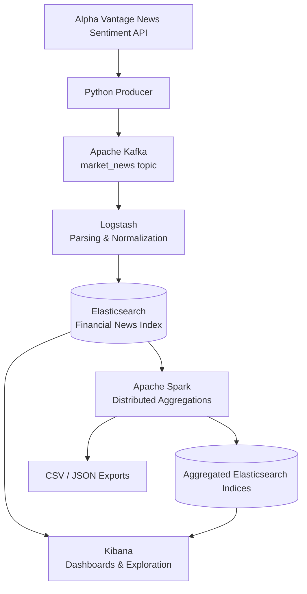

# Market News Data Pipeline

An end-to-end financial news data pipeline designed to collect, process, index and analyze financial news and sentiment data using a distributed data engineering architecture.

Built with Python, Apache Kafka, Logstash, Elasticsearch, Kibana and Apache Spark, orchestrated using Docker Compose.

##  Architecture



##  Data Pipeline

### 1. Data Ingestion

**Python · Alpha Vantage API**

- Retrieve financial news and sentiment information using the Alpha Vantage News Sentiment API.
- Monitor selected financial tickers: AAPL, MSFT and GOOGL.
- Extract article metadata, publication dates and sentiment scores.
- Normalize JSON responses into structured documents.
- Avoid duplicate publications using article URLs as identifiers.
- Publish messages to the Kafka topic `market_news`.

The producer polls the API every hour.

### 2. Message Streaming

**Apache Kafka · Zookeeper**

Kafka acts as the message broker between data ingestion and downstream processing.

- Publish financial news events to the `market_news` topic.
- Decouple the producer from the processing layer.
- Allow Logstash to consume incoming messages independently.

### 3. Data Transformation

**Logstash**

Logstash consumes messages from Kafka and prepares them for indexing.

- Parse incoming JSON events.
- Normalize publication timestamps.
- Standardize sentiment field names.
- Forward structured documents to Elasticsearch.

### 4. Data Indexing

**Elasticsearch 8.12.2**

Financial news articles are stored in Elasticsearch using date-based indices.

- Index structured financial news documents.
- Support full-text search and filtering.
- Enable sentiment-based aggregations and analysis.

### 5. Distributed Processing

**Apache Spark 3.4.2 · PySpark**

Spark reads indexed articles from Elasticsearch and performs distributed aggregations.

Three analytical dimensions are calculated:

| Aggregation | Metrics |
|---|---|
| Daily statistics | Article count and average sentiment score |
| Media sources | Article count and average sentiment by source |
| Sentiment distribution | Article count and average score by sentiment category |

Results are written back to dedicated Elasticsearch indices and exported in CSV and JSON formats.

### 6. Data Visualization

**Kibana**

Explore indexed financial news and analytical results through interactive dashboards and visualizations.

## 🛠️ Technology Stack

| Component | Technology |
|---|---|
| Data Source | Alpha Vantage API |
| Programming | Python 3.11+ |
| Streaming | Apache Kafka |
| Coordination | Apache Zookeeper |
| Transformation | Logstash |
| Search & Indexing | Elasticsearch 8.12.2 |
| Distributed Processing | Apache Spark 3.4.2 |
| Visualization | Kibana |
| Containerization | Docker Compose |

## Project Structure

```text
market-news-data-pipeline/
│
├── producer/
│   ├── producer.py
│   └── requirements.txt
│
├── elastic/
│   └── index-template.json
│
├── logstash/
│   └── pipeline.conf
│
├── spark/
│   ├── job.py
│   └── output/
│
├── elasticsearch-queries/
│   └── QUERIES.md
│
├── kibana/
│   └── VISUALIZATIONS.md
│
├── images/
│
├── docker-compose.yml
└── README.md
```

##  Getting Started

### Prerequisites

- Docker Desktop 24.x
- Python 3.11+
- Alpha Vantage API key

### 1. Clone the repository

```bash
git clone https://github.com/FellatiZineb/market-news-data-pipeline.git

cd market-news-data-pipeline
```

### 2. Configure API credentials

Create a `.env` file inside the `producer/` directory:

```env
ALPHAVANTAGE_API_KEY=your_api_key
```

Install Python dependencies:

```bash
cd producer

python -m venv .venv

# Windows
.venv\Scripts\activate

# Linux / macOS
source .venv/bin/activate

pip install -r requirements.txt
```

### 3. Start the infrastructure

From the project root:

```bash
docker compose up -d
```

Check running containers:

```bash
docker compose ps
```

### 4. Run the producer

```bash
cd producer
python producer.py
```

### 5. Execute Spark aggregations

```bash
docker compose exec spark /opt/spark/bin/spark-submit \
  --master local[*] \
  --jars /tmp/spark-deps/es-spark.jar \
  /opt/spark-jobs/job.py
```

### 6. Explore Kibana

Open:

http://localhost:5601

Elasticsearch is accessible from your host at:

http://localhost:9201

##  Sample Results

Results documented from one execution of the project:

| Metric | Result |
|---|---:|
| Financial news articles | 50 |
| Distinct media sources | 24 |
| Average sentiment score | 0.151 |
| Observation period | 19 days |

### Sentiment Distribution

| Sentiment | Articles | Distribution |
|---|---:|---:|
| Somewhat Bullish | 21 | 42% |
| Neutral | 20 | 40% |
| Bullish | 6 | 12% |
| Somewhat Bearish | 3 | 6% |

### Spark Output Indices

- `market-news-stats-daily`
- `market-news-stats-by-source`
- `market-news-stats-by-sentiment`

##  Key Engineering Concepts

- Event-driven data ingestion with Apache Kafka.
- Decoupled data processing architecture.
- JSON parsing and data normalization.
- Distributed data processing with Apache Spark.
- Search and indexing with Elasticsearch.
- Analytical aggregations and data visualization.
- Containerized infrastructure using Docker Compose.

##  Authors

**Zineb Fellati** and **Mohamed Amine Benali**

M2 DataScale Université de Versailles Saint-Quentin-en-Yvelines.

Academic project, 2025–2026.

---
 If you find this project interesting, feel free to explore the repository!
